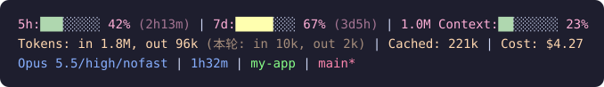

# claude-statusline

A three-line status line for Claude Code: plan limits and context as bars, token, cache and cost totals, then model, effort, session time, project and git branch.



```text
5h:███░░░░░ 42% (2h13m) | 7d:█████░░░ 67% (3d5h) | 1.0M Context:██░░░░░░ 23%
Tokens: in 1.8M, out 96k (本轮: in 10k, out 2k) | Cached: 221k | Cost: $4.27
Opus 5.5/high/nofast | 1h32m | my-app | main*
```

To set it up on another machine, give your agent this prompt:

> Install the Claude Code status line from https://github.com/nvmmonkey/claude-statusline. Follow the "Install (for agents)" section of its README.

## What it shows

| Line | Segment | From the status payload | Notes |
|---|---|---|---|
| 1 | `5h`, `7d` | `rate_limits.five_hour`, `rate_limits.seven_day` | Plan usage, with the time until it resets in parentheses. Left out when Claude Code doesn't send `rate_limits`. |
| 1 | `1.0M Context` | `context_window.context_window_size`, `context_window.used_percentage` | Window size and how full it is. |
| 2 | `Tokens` | `context_window.total_input_tokens`, `context_window.total_output_tokens` | Session totals. `本轮` ("this turn") is the latest request: input plus cache-write tokens, and output tokens. |
| 2 | `Cached` | `context_window.current_usage.cache_read_input_tokens` | Cache reads of the latest request. |
| 2 | `Cost` | `cost.total_cost_usd` | Session cost as Claude Code estimates it. |
| 3 | Model | `model.display_name`, `effort.level`, `fast_mode` | For example `Opus 5.5/high/nofast`. Anything in parentheses in the model name is dropped. |
| 3 | Duration | `cost.total_duration_ms` | Session wall time. |
| 3 | Project, branch | `workspace.project_dir`, then `git` | Folder name and branch. `*` means tracked files have changes. |

Bars are green below 50 %, yellow from 50 % and red from 80 %. In a narrow terminal, line 1 drops the reset times and then the bars (percentages only), line 2 drops the this-turn detail and then the token totals, and line 3 drops the branch and then the duration.

## Install (for agents)

You are installing a status line for Claude Code. Change only the `statusLine` key in the user's own settings file, `~/.claude/settings.json`. Leave every other key alone, and don't touch project settings (`.claude/settings.json` or `.claude/settings.local.json` inside a repository).

Requirements: Python 3.8 or newer (`python3`, or `python` on Windows). `git` is optional; without it the branch segment is left out.

### macOS, Linux, WSL

```bash
# 1. Get the repo, or update it if it is already there
dest="$HOME/.local/share/claude-statusline"
if [ -d "$dest/.git" ]; then
  (cd "$dest" && gh repo sync 2>/dev/null) || git -C "$dest" pull --ff-only
else
  gh repo clone nvmmonkey/claude-statusline "$dest" 2>/dev/null \
    || git clone https://github.com/nvmmonkey/claude-statusline.git "$dest"
fi

# 2. Install
"$dest/install.sh"
```

The repository is private. The `gh` commands use the GitHub CLI login. The plain `git` fallbacks only work if git itself has GitHub credentials. If both fail, ask the user to run `gh auth login` and try again.

`install.sh` does four things:

1. Copies `tt-statusline.py` to `~/.claude/tt-statusline.py`.
2. Backs up `~/.claude/settings.json` to `settings.json.bak.<timestamp>`, if the file exists.
3. Sets `statusLine` to `{"type": "command", "command": "<python3> <home>/.claude/tt-statusline.py"}` with absolute paths and keeps every other key. A symlinked `settings.json` is written through to its target.
4. Renders `sample-input.json` once and exits non-zero unless that prints three lines.

If `settings.json` isn't valid JSON, the installer stops before changing it. Show the user the error instead of rewriting the file yourself. If `CLAUDE_CONFIG_DIR` is set, the installer uses that folder instead of `~/.claude`.

When it succeeds, tell the user the backup path and the `command:` line. If the output has a `replaced:` line, include it too: that is the status line it replaced. Don't run `tt setup` afterwards; it replaces this script (see Notes).

### Windows without bash

This path hasn't been tested. The script itself handles Windows consoles.

1. Copy `tt-statusline.py` to `%USERPROFILE%\.claude\tt-statusline.py`.
2. If `%USERPROFILE%\.claude\settings.json` exists, copy it to `settings.json.bak` in the same folder.
3. Parse `settings.json`, set only the `statusLine` key and write the file back:

   ```json
   "statusLine": {
     "type": "command",
     "command": "C:\\Python312\\python.exe C:\\Users\\you\\.claude\\tt-statusline.py"
   }
   ```

   Use the real paths: `where python` for the interpreter and `%USERPROFILE%` for the script. Put a path that contains spaces in escaped double quotes (`\"C:\\Program Files\\...\"`).

### Check it

```bash
python3 -c 'import json, os; print(json.load(open(os.path.expanduser("~/.claude/settings.json")))["statusLine"])'

script="$HOME/.claude/tt-statusline.py"
sample="$HOME/.local/share/claude-statusline/sample-input.json"
HOME="$(mktemp -d)" python3 "$script" < "$sample"
```

You should see the `statusLine` entry, then three lines like the preview, with `my-app` and no branch. The temporary `HOME` stops this test from overwriting `~/.claude/tt-status.json`.

The status line appears after the next message in Claude Code. If it doesn't, restart Claude Code.

### Uninstall

1. Delete the `statusLine` key from `~/.claude/settings.json`, or set it back to the value the installer printed after `replaced:`.
2. Run `rm ~/.claude/tt-statusline.py ~/.claude/tt-status.json`.

## Customize

Edit `tt-statusline.py` in this repo, then re-run `./install.sh`, so the repo stays the copy you keep.

- `THEME`, near the top of the file: `mocha` (the default), `dracula` or `default`. `mocha` and `dracula` use 256 colours. They fall back to `default` unless `TERM` contains `256color` or `COLORTERM` is `truecolor` or `24bit`.
- `color_by_pct`: the 50 % and 80 % bar thresholds.
- `render()`: what goes on each line, and what drops first when space runs out.

## Notes

- **Where it comes from.** This started as the status line that the `token-tracker` Python package installs: version 0.3.6, command `tt`, hook version 1.6. It has these layout changes:
  - project and branch moved from the start of line 1 to the end of line 3;
  - the `Model:` and `Duration:` labels removed;
  - minutes shown as `mins` instead of `min`.
- **Why the file is still called `tt-statusline.py`.** `tt` decides that it is set up when the `statusLine` command contains `tt-statusline` and the script's `__version__` matches its own. Keeping both means `tt` leaves this version alone. Some `tt` actions rewrite the script with the stock layout; re-run `install.sh` after any of them:
  - `tt setup`;
  - an upgrade that ships a new hook version;
  - any `tt` run that decides it isn't set up (it also checks the Codex status line).
- **It writes one file.** Every refresh saves the whole status payload to `~/.claude/tt-status.json`: session id, transcript path, working folder, cost and rate limits. `tt` reads the rate limits from that file. Nothing leaves the machine.
- **Git on every refresh.** Each refresh runs `git branch --show-current` and `git status --porcelain --untracked-files=no` in the project folder, each with a 2-second timeout.
- **Licence.** token-tracker ships without a licence, so this repository is private and has no LICENSE file.

## Files

| File | What it is |
|---|---|
| `tt-statusline.py` | The status line script. It needs only the Python standard library. |
| `install.sh` | Installer for macOS, Linux and WSL. Safe to re-run. |
| `statusline.settings.json` | The `statusLine` settings entry, for reference. The installer writes the same entry with absolute paths. |
| `sample-input.json` | A made-up status payload for testing. |
| `preview.svg` | The image at the top of this page. |

Tested with Claude Code 2.1.287 on Linux. If an older Claude Code doesn't send a field, its segment is left out.
